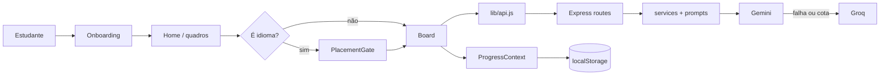

# Lumio

<p align="center">
  
</p>

<p align="center">
  <strong>Luz para o aprendizado.</strong> Um MVP local de estudos com IA, organizado em <strong>quadros</strong>.
</p>

> **Resumo:** React + Express, sem banco e sem login. O perfil fica no `localStorage`; o conteúdo é gerado pelo Gemini, com fallback automático para Groq. As chaves de API ficam apenas no servidor.

Quadros atuais:

| ID | Nome | Objetivo |
|---|---|---|
| `chat` | Chat | conversa no idioma-alvo com correção em PT-BR |
| `quiz` | Idiomas | 5 perguntas de múltipla escolha, com listening/speaking |
| `materias` | Matérias | 5 perguntas de Português, Matemática, História, Geografia e Ciências |
| `curiosidades` | Curiosidades | 10 perguntas de cultura geral |
| `dialogos` | Diálogos | conversa entre duas pessoas com 2 perguntas de compreensão |
| `memoria` | Memória | jogo de pares palavra ↔ significado com desenhos SVG locais; sem IA na rodada, mas com teste de nível |

Idiomas: Inglês, Espanhol e Francês. Nível CEFR por idioma: `A1`–`C2`, limitado pela idade do perfil. Gamificação com XP, ofensiva e meta diária, também por matéria/sujeito.

> Perfil do estudante (nome, idade, objetivo, escolaridade e interesses) é coletado no onboarding, salvo localmente e injetado nos prompts; o avatar faz parte do perfil, mas é apenas visual. Nada é enviado para banco externo.

### Fluxo em 30 segundos



---

## Sumário

1. [Ferramentas e stack](#ferramentas-e-stack)
2. [Mapa do que foi feito](#mapa-do-que-foi-feito)
3. [Roteiro de estudo](#roteiro-de-estudo)
4. [Aprendizados React](#aprendizados-react)
5. [Identidade visual](#identidade-visual)
6. [Estrutura de arquivos](#estrutura-de-arquivos)
7. [Pré-requisitos e instalação](#pré-requisitos-e-instalação)
8. [Como rodar](#como-rodar)
9. [Arquitetura](#arquitetura)
10. [Quadros e rotas](#quadros-e-rotas)
11. [Onboarding e perfil](#onboarding-e-perfil)
12. [Backend](#backend)
13. [Frontend](#frontend)
14. [Contrato da API](#contrato-da-api)
15. [Persistência local](#persistência-local)
16. [Segurança](#segurança)
17. [Como estender](#como-estender)
18. [Troubleshooting](#troubleshooting)
19. [Estado atual / roadmap](#estado-atual--roadmap)
20. [Migração React](#migração-react)

---

## Ferramentas e stack

| Ferramenta | Versão / forma de uso | Papel no Lumio | Onde ver |
|---|---|---|---|
| Node.js | `>=20.3` — validado em `22.19.0` | runtime do backend, build do Vite e APIs nativas (`fetch`, `AbortSignal.any`) | `package.json`, `server/` |
| Express | `^4.19.2` | API REST, `express.json`, `express.static` e rota `/board/:id` | `server/index.js` |
| dotenv | `^16.4.5` | carrega `.env` no startup do servidor | `server/index.js` |
| React | `^18.3.1` | interface em componentes e contexts | `frontend/src/` |
| react-dom | `^18.3.1` | renderização no browser | `frontend/src/main.jsx` |
| Vite | `^8.3.8` | dev server com HMR, proxy `/api` e build de produção | `frontend/vite.config.js` |
| @vitejs/plugin-react | `^6.3.0` | JSX e Fast Refresh no Vite | `frontend/vite.config.js` |
| Tailwind CSS | `^3.4.17` | utilitários de layout, tema claro/escuro e tokens | `frontend/tailwind.config.js` |
| PostCSS | `^8.4.49` | pipeline CSS do Tailwind | `frontend/postcss.config.js` |
| Autoprefixer | `^10.4.20` | compatibilidade de CSS | `frontend/postcss.config.js` |
| Google Gemini API | REST `generativelanguage.googleapis.com/v1beta` | geração de chat, quiz, matérias, curiosidades, diálogos e placement | `server/services/gemini-client.js` |
| Groq API | REST OpenAI-compatible `api.groq.com/openai/v1/chat/completions` | fallback quando Gemini falha ou está sem cota | `server/services/groq-client.js` |
| Web Speech API | `speechSynthesis` | narração/ listening no navegador | `frontend/src/lib/sound.js` |
| Web Audio API | `AudioContext` | efeitos de acerto, erro e vitória | `frontend/src/lib/sound.js` |
| `localStorage` | API nativa | perfil, XP, níveis, tema, som e estado dos quadros | `frontend/src/lib/storage.js` |
| `node:crypto` | `createHmac`, `timingSafeEqual` | token HMAC do teste de nível | `server/services/placement.js` |

O Express serve somente o build React de `frontend/dist/`. Não há Alpine.js, CDN de frontend, banco de dados, autenticação, testes automatizados ou lint no repositório.

---

## Mapa do que foi feito

Use esta tabela para localizar uma decisão, copiar o padrão ou estudar o porquê dela.

| Tema | Onde está | O que foi feito | Como aplicar em outro projeto |
|---|---|---|---|
| Shell em colunas | `AppShell.jsx`, `Sidebar.jsx`, `Topbar.jsx`, `Footer.jsx` | sidebar full-height própria; topbar/footer na coluna de conteúdo; hambúrguer só no mobile | prefira `flex` com coluna lateral e coluna de conteúdo em vez de `padding-left` global |
| Navegação sem router | `UiContext.jsx` | rotas `/` e `/board/:id` via History API (`pushState`, `popstate`) | centralize `route`/`activeBoard` num context e sincronize com a URL |
| Onboarding adaptativo | `OnboardingOverlay.jsx`, `student-context.js` | perfil normalizado e injetado em todos os prompts | sanitize e transforme perfil em contexto antes de montar o prompt |
| Teste de nível | `PlacementGate.jsx`, `PlacementContext.jsx`, `routes/placement.js`, `services/placement.js` | 6 perguntas `A1`–`C2`, token HMAC sem gabarito, clamp por idade | nunca envie respostas corretas ao cliente; use HMAC + TTL |
| Registro de boards | `constants.js`, `BoardPage.jsx` | `CORE_BOARDS` com `id`, `kind` e `subject`; renderização por `kind` | troque `if/else` solto por registry + switch único |
| Chamadas de IA | `api.js`, `routes/*`, `services/*`, `gemini-client.js`, `groq-client.js` | fetch centralizado, validação HTTP, prompt/schema/parser no service, fallback Gemini → Groq | mantenha controller/route fino e regra de negócio no service |
| Qualidade das perguntas | `question-check.js` | validação de acento, sinal de `?` e redação antes de responder | trate saída de LLM como dado não confiável |
| Memória sem IA | `memory-decks.js`, `WordArt.jsx`, `MemoriaBoard.jsx` | decks locais, pares com mesmo SVG nas duas cartas, rotação via `memory_seen` | use estado local quando a rodada não precisar de geração |
| XP e metas | `ProgressContext.jsx` | progresso agregado por `subject`, datas locais, bônus de rodada | separe estado por domínio e agregue no getter |
| Áudio e voz | `sound.js` | Web Audio para efeitos, `speechSynthesis` para narração | isole APIs do navegador num módulo e exponha funções simples |
| Tema e acessibilidade | `styles.css`, `tailwind.config.js` | `darkMode: 'class'`, tokens de acento e `prefers-reduced-motion` | coloque tokens em CSS e não espalhe cores hardcoded |
| Segurança | `server/index.js`, `routes/*`, `prompts.js` | whitelist, limites de payload/string, chaves só no servidor | valide na borda e nunca confie no payload do cliente |

---

## Roteiro de estudo

1. **Suba o projeto**: `npm install`, `cp .env.example .env`, preencha uma chave e rode `npm run server:dev` + `npm run dev`.
2. **Entenda o mapa**: leia `frontend/src/lib/constants.js` e veja os seis boards em `CORE_BOARDS`.
3. **Siga uma requisição**: de `ChatBoard.jsx` → `lib/api.js` → `server/routes/chat.js` → `server/services/gemini.js` → `gemini-client.js`.
4. **Estude o gate**: leia `PlacementGate.jsx`, depois `POST /api/placement/start` e `/finish`. Compare o token com o gabarito que **não** vai para o browser.
5. **Estude resiliência**: em `gemini-client.js`, observe retry, timeout, abort e a passagem para `groq-client.js`.
6. **Estude estado local**: em `storage.js` e `ProgressContext.jsx`, veja leitura tolerante a falha e agregação por `subject`.
7. **Estude o jogo local**: em `memory-decks.js`, veja como `memory_seen` evita repetir pares sem chamar a API.
8. **Aplique**: escolha um item do [mapa acima](#mapa-do-que-foi-feito) e tente reproduzir o padrão em um componente novo.

---

## Aprendizados React

Tudo nesta seção acontece no frontend. O backend apenas recebe JSON e devolve JSON; a interface decide estado, navegação e experiência.

### Árvore de componentes

```text
main.jsx
└── AppProviders
    ├── OnboardingProvider
    ├── UiProvider
    ├── PlacementProvider
    └── ProgressProvider
        └── App
            └── AppShell
                ├── Sidebar              # desktop
                ├── coluna de conteúdo
                │   ├── Topbar
                │   ├── <main>
                │   │   ├── HomePage
                │   │   └── BoardPage
                │   │       ├── ClearBoardButton
                │   │       └── board por kind:
                │   │           ChatBoard, QuizBoard, MateriasBoard,
                │   │           CuriosidadesBoard, DialogosBoard, MemoriaBoard
                │   │               └── BoardUi / WordArt
                │   └── Footer
                ├── MobileMenu           # mobile
                ├── PlacementGate        # chat, quiz, dialogos, memoria
                └── OnboardingOverlay
```

### Rotas sem React Router

| URL | Estado no `UiContext` | Componente |
|---|---|---|
| `/` | `route === 'home'` | `HomePage` |
| `/board/chat` | `activeBoard.id === 'chat'` | `ChatBoard` |
| `/board/quiz` | `activeBoard.id === 'quiz'` | `QuizBoard` |
| `/board/materias` | `activeBoard.id === 'materias'` | `MateriasBoard` |
| `/board/curiosidades` | `activeBoard.id === 'curiosidades'` | `CuriosidadesBoard` |
| `/board/dialogos` | `activeBoard.id === 'dialogos'` | `DialogosBoard` |
| `/board/memoria` | `activeBoard.id === 'memoria'` | `MemoriaBoard` |

`openBoard()`, `goHome()` e `closeBoard()` chamam `history.pushState()`; `syncFromLocation()` escuta `popstate`. O Express só conhece explicitamente `GET /board/:id`; todo o resto é SPA navegada no cliente.

### Contexts e hooks próprios

`AppProviders.jsx` compõe os quatro providers. Cada context expõe um hook próprio baseado em `useContext`:

| Hook | Arquivo | Responsabilidade |
|---|---|---|
| `useUi()` | `contexts/UiContext.jsx` | boards, rota, `activeBoard`, tema, som, sidebar, nível e `subject` por board |
| `useProgress()` | `contexts/ProgressContext.jsx` | XP, ofensiva, meta diária e agregados por `subject` |
| `useOnboarding()` | `contexts/OnboardingContext.jsx` | etapas, formulário, perfil, validação e preview do avatar |
| `usePlacement()` | `contexts/PlacementContext.jsx` | teste de nível por idioma, gate e resultado persistido |

### Hooks React usados de verdade

| Hook | Uso no Lumio |
|---|---|
| `useState` | formulários, rodadas, loading, erros e flags de UI |
| `useEffect` | sincronizar URL, persistir estado, iniciar boards e limpar requests |
| `useRef` | guardar `AbortController` e refs de auto-start sob `StrictMode` |
| `useCallback` | estabilizar handlers passados para efeitos e componentes filhos |
| `useMemo` | derivar listas e valores sem recalcular a cada render |
| `useContext` | consumido pelos hooks `useUi`, `useProgress`, `useOnboarding` e `usePlacement` |
| `React.StrictMode` | expõe efeitos impuros; por isso o auto-start usa ref |

Não há `useReducer`, React Router, Redux nem biblioteca externa de estado.

### Padrões para copiar

| Padrão | Onde ver | Por que usar |
|---|---|---|
| Registry em vez de condicionais soltos | `lib/constants.js` + `BoardPage.jsx` | adicionar board vira dados + um `case`, não uma cadeia de `if` |
| Context por domínio | `contexts/*.jsx` | evita um context único com responsabilidades misturadas |
| `lib/` como camada de borda | `api.js`, `storage.js`, `sound.js` | componentes não sabem detalhes de `fetch`, `localStorage` ou áudio |
| Refs para auto-start | boards com `startRoundRef` | `StrictMode` não dispara duas requisições |
| Getters derivados | `level()`, `goalProgress`, `continueBoard` | estado mínimo; valores calculados não ficam dessincronizados |
| Composição de shell | `AppShell.jsx` | sidebar, topbar, main e footer evoluem separadamente |
| Texto, não HTML | boards renderizam respostas da IA como texto | sem `dangerouslySetInnerHTML`; XSS fica fora |

---

## Identidade visual

<p align="center">
  
</p>

O mascote é **Lumi**, um vaga-lume: a luz no abdomen representa o aprendizado acendendo. Ele mantém os mesmos arquivos por faixa etária, então `profile.js` continua resolvendo `baby | teen | adult` sem mudança de contrato.

| Faixa etária | Lumi | Detalhe |
|---|---|---|
| 3–10 anos |  | olhos grandes, brilho suave e faíscas |
| 11–17 anos |  | fone de ouvido e caderno |
| 18+ |  | óculos e livro |

<p align="center">
  
</p>

Os SVGs são locais e versionados em `frontend/public/img/`. A mesma linguagem visual aparece no favicon, nos logos e no avatar gerado por `avatar.js`. Não há screenshots versionados; os assets acima são exatamente os usados pelo app.

---

## Estrutura de arquivos

```text
app-lumio/
├── server/
│   ├── index.js                    # bootstrap: middlewares, mounts, /board/:id
│   ├── prompts.js                  # CEFR, SUBJECTS, resolveLevel/resolveSubject, prompts de chat/quiz
│   ├── routes/
│   │   ├── chat.js                 # POST /api/chat
│   │   ├── quiz.js                 # POST /api/quiz
│   │   ├── materias.js             # POST /api/materias
│   │   ├── curiosidades.js         # POST /api/curiosidades
│   │   ├── dialogos.js             # POST /api/dialogos
│   │   └── placement.js            # POST /api/placement/start e /finish
│   └── services/
│       ├── ai-keys.js              # validação de chaves GEMINI/GROQ
│       ├── gemini-client.js        # chamada ao Gemini + fallback para Groq
│       ├── groq-client.js          # adaptador OpenAI-compatible do Groq
│       ├── gemini.js               # chat
│       ├── quiz.js                 # Idiomas (JSON estruturado + shuffle)
│       ├── materias.js             # Matérias (registry MATERIAS)
│       ├── curiosidades.js         # Curiosidades (CATEGORIES + shuffle de opções)
│       ├── dialogos.js             # Diálogos (DIALOG_SUBJECTS)
│       ├── student-context.js      # normalização e injeção do perfil nos prompts
│       ├── placement.js            # teste de nível, token HMAC, cálculo do CEFR
│       └── question-check.js       # validação de acentos e redação de perguntas
│
├── frontend/                       # único frontend (React/Vite)
│   ├── index.html
│   ├── vite.config.js              # proxy /api -> Express, build em dist/
│   ├── tailwind.config.js          # mesmas cores/tokens do tema atual
│   ├── postcss.config.js
│   ├── package.json                # scripts dev/build/preview do Vite
│   ├── package-lock.json
│   ├── public/img/
│   │   ├── app-icon.svg            # favicon + ícone do app
│   │   ├── logo.svg                # wordmark claro (asset disponível)
│   │   ├── logo-dark.svg           # wordmark escuro (asset disponível)
│   │   ├── mascot.svg              # Lumi adulto
│   │   ├── mascot-baby.svg         # Lumi 3–10 anos
│   │   └── mascot-teen.svg         # Lumi 11–17 anos
│   └── src/
│       ├── main.jsx
│       ├── App.jsx                 # renderiza AppShell
│       ├── styles.css              # Tailwind, tokens, acentos e animações
│       ├── lib/
│       │   ├── api.js              # chamadas /api/*
│       │   ├── avatar.js           # SVG data URI do avatar
│       │   ├── constants.js        # boards, idiomas, matérias, níveis, rotas
│       │   ├── profile.js          # normalização do perfil e mascotes
│       │   ├── sound.js            # Web Audio + Web Speech API
│       │   ├── placement.js        # regras do teste de nível
│       │   ├── memory-decks.js     # decks locais do jogo de memória
│       │   └── storage.js          # wrappers do localStorage
│       ├── contexts/
│       │   ├── AppProviders.jsx
│       │   ├── OnboardingContext.jsx
│       │   ├── UiContext.jsx
│       │   ├── PlacementContext.jsx
│       │   └── ProgressContext.jsx
│       └── components/
│           ├── AppShell.jsx
│           ├── Sidebar.jsx
│           ├── Topbar.jsx
│           ├── MobileMenu.jsx
│           ├── Footer.jsx
│           ├── HomePage.jsx
│           ├── OnboardingOverlay.jsx
│           ├── PlacementGate.jsx
│           ├── BoardPage.jsx
│           ├── BoardUi.jsx
│           ├── ClearBoardButton.jsx
│           ├── Icons.jsx
│           ├── ChatBoard.jsx
│           ├── QuizBoard.jsx
│           ├── MateriasBoard.jsx
│           ├── CuriosidadesBoard.jsx
│           ├── DialogosBoard.jsx
│           ├── MemoriaBoard.jsx
│           └── WordArt.jsx             # desenhos SVG locais dos pares de memória
│
├── .env                            # segredos locais (não versionar)
├── .env.example
├── .gitignore
├── package.json
└── package-lock.json
```

`logo.svg` e `logo-dark.svg` são usados neste README. O app usa `app-icon.svg` como favicon e ícone; Lumi é escolhido pela faixa etária do perfil.

---

## Pré-requisitos e instalação

- Node com `fetch`, `AbortSignal.timeout` e `AbortSignal.any` — use **Node 20.3+** (`AbortSignal.any()` exige 20.3; validado em Node 22).
- Chave de API do Google AI Studio: <https://aistudio.google.com/apikey>.
- Opcional: chave do Groq como fallback gratuito: <https://console.groq.com/keys>.

```bash
npm install
cp .env.example .env
# preencha GEMINI_API_KEY e/ou GROQ_API_KEY em .env
```

`.env` está no `.gitignore`; `.env.example` é versionado e serve apenas como modelo.

`.env`:

```dotenv
GEMINI_API_KEY=sua_chave_aqui
# GROQ_API_KEY=sua_chave_groq_aqui
# GROQ_MODELS=openai/gpt-oss-120b,openai/gpt-oss-20b
# PLACEMENT_SECRET=segredo_local_para_tokens_de_nivelamento  # recomendado
# PORT=3000  # opcional
```

Se `GEMINI_API_KEY` estiver sem cota, o servidor tenta o Groq automaticamente quando `GROQ_API_KEY` existe. Também é possível rodar só com Groq. Modelos gratuitos padrão: `openai/gpt-oss-120b` e `openai/gpt-oss-20b`.

Se `PLACEMENT_SECRET` estiver vazio, o servidor usa `GEMINI_API_KEY` ou `GROQ_API_KEY` como fallback para assinar os tokens do teste de nível.

---

## Como rodar

```bash
npm run frontend:build # gera frontend/dist/
npm start              # Express serve frontend/dist/ em http://localhost:3000
```

`PORT` é opcional (padrão `3000`). `npm start` falha com mensagem clara se `frontend/dist/index.html` não existir.

Para desenvolvimento com hot reload:

```bash
npm run server:dev     # Express em http://localhost:3000
npm run dev            # Vite em http://localhost:5173, com proxy /api
```

Atalhos mantidos: `npm run build` = `npm run frontend:build`; `npm run preview` = `npm run frontend:preview`.

Não há scripts de `test` ou `lint`.

---

## Arquitetura

```text
Navegador
  React 18 (frontend/dist/)
    contexts: Onboarding, Ui, Placement, Progress
    components: AppShell, Sidebar, Topbar, MobileMenu, Footer, BoardPage, BoardUi, PlacementGate, OnboardingOverlay, ClearBoardButton, Icons, WordArt, seis boards
    lib: api, avatar, constants, profile, sound, placement, memory-decks, storage
  localStorage
        |
        | POST /api/< board >
        v
Express (server/index.js)
  routes/*        -> validação HTTP e erro
  services/*      -> prompt, schema, parser, regra de negócio
  gemini-client   -> modelos Gemini, fallback para Groq, timeout, parse
  groq-client     -> chat completions, schema JSON, fallback de modelos
  student-context -> adaptação ao perfil
        |
        +--> Google Gemini API
        `--> Groq API (quando GROQ_API_KEY existe)
```

O navegador nunca chama Gemini ou Groq diretamente. As chaves ficam apenas no servidor.

---

## Quadros e rotas

### Rotas do app

| Rota | Significado |
|---|---|
| `/` | home: sidebar full-height no desktop, expansível com labels e botão de fechar; reabertura por alça na borda esquerda; topbar e footer na coluna de conteúdo, sem sobrepor a sidebar; menu hambúrguer no mobile, hero "Continuar de onde parou" e grid de quadros |
| `/board/chat` | quadro Chat |
| `/board/quiz` | quadro Idiomas |
| `/board/materias` | quadro Matérias |
| `/board/curiosidades` | quadro Curiosidades |
| `/board/dialogos` | quadro Diálogos |
| `/board/memoria` | quadro Memória |

`express.static(frontend/dist/)` serve `index.html` em `/` e `/index.html`; `GET /board/:id` é a única rota explícita da SPA. Não existe catch-all/fallback genérico para qualquer path. Navegação usa History API via `UiContext` (`history.pushState`/`replaceState` e `popstate`).

A topbar tem altura fixa `h-16` (`Topbar.jsx`); o footer é flexível (`min-h-10 shrink-0`, `Footer.jsx`) e ambos ficam na coluna de conteúdo. Em `/board/:id`, o painel usa `h-[calc(100vh-8.75rem)]` no mobile e `lg:h-[calc(100vh-8.5rem)]` (`BoardPage.jsx`).

### Registry dos quadros

`frontend/src/lib/constants.js` mantém `CORE_BOARDS`:

```js
[
  { id: 'chat',          kind: 'chat',          subject: 'english' },
  { id: 'quiz',          kind: 'quiz',          subject: 'english' },
  { id: 'materias',      kind: 'materias',      subject: 'portugues' },
  { id: 'curiosidades',  kind: 'curiosidades',  subject: 'curiosidades' },
  { id: 'dialogos',      kind: 'dialogos',      subject: 'english' },
  { id: 'memoria',       kind: 'memoria',       subject: 'english' },
]
```

`UiProvider` sempre reconstrói esses seis quadros, mescla `subject` salvo em `boards_list` e usa `board_languages` como fallback para `chat`, `quiz`, `dialogos` e `memoria`. Não há adicionar/remover quadros pela UI.

### Resumo por componente

| Componente | Rodada | API | XP |
|---|---:|---|---|
| `chat` | contínua | `/api/chat` | não dá XP por mensagem; registra prática |
| `quiz` | 5 | `/api/quiz` | `+10` por acerto, `+5` ao concluir |
| `materias` | 5 | `/api/materias` | `+10` por acerto, `+5` ao concluir |
| `curiosidades` | 10 | `/api/curiosidades` | `+10` por acerto |
| `dialogos` | 2 perguntas | `/api/dialogos` | `+10` por acerto |
| `memoria` | 6 pares (A1/A2) ou 8 (B1–C2) | nenhuma na rodada; `/api/placement/*` no gate | `+10` por par + bônus ao concluir |

`curiosidades` e `dialogos` usam esses nomes como `subject` de progresso, embora não sejam idiomas. `memoria` usa decks locais com desenhos SVG em `frontend/src/components/WordArt.jsx`; a carta no idioma-alvo e a carta em português mostram o mesmo desenho. Guarda em `memory_seen` os pares já usados por idioma/nível; ao terminar ou limpar, a próxima rodada usa pares ainda não vistos e só reinicia o ciclo quando o pool acaba. Como é board de idioma, também passa pelo `PlacementGate` antes da primeira rodada.

---

## Onboarding e perfil

Overlay em `frontend/src/components/OnboardingOverlay.jsx` com quatro etapas:

1. **Perfil**: identificação do estudante — nome, idade, objetivo, escolaridade, até 3 interesses.
2. **Avatar**: vem imediatamente após **Perfil**; escolhe cor do corpo, roupa (`none | shirt | hoodie | blazer`) e acessório (`none | glasses | headphones | cap`).
3. **Quadro**: escolhe um dos boards e abre direto a rota correspondente.
4. **Praticar**: overlay fechado e board ativo.

No mobile, o stepper compacta os rótulos em `Etapa X de 4` + nome da etapa + barra de progresso; os quatro rótulos lado a lado ficam apenas em `sm+`.

O avatar é gerado como data URI de SVG inline por `frontend/src/lib/avatar.js`; não usa asset externo nem chamada de backend. A escolha fica em `student_profile` como `avatar: { body, outfit, accessory }`. A idade continua definindo o estágio base (`baby | teen | adult`); roupa e acessório são apenas visuais e não alteram nível, XP, prompts nem conteúdo. Ao editar o perfil, o fluxo passa novamente pela etapa Avatar.

Chave: `student_profile`. Estado normalizado por `normalizeProfile()`:

- `name`: texto até 60 caracteres;
- `age`: inteiro de 3 a 100, senão `null`;
- `objective`: `idiomas | escolar | curiosidades | geral` (padrão `geral`);
- `schooling`: `infantil | fundamental | medio | superior | autodidato`;
- `interests`: até 3 de `ciencia | espaco | natureza | historia | tecnologia | cultura`;
- `avatar`: `{ body, outfit, accessory }` com os valores aceitos acima.

Estágio base e mascote por idade:

| Idade | Estágio | Asset |
|---|---|---|
| `<3` ou inválida | `adult` | `/img/mascot.svg` |
| `3–10` | `baby` | `/img/mascot-baby.svg` |
| `11–17` | `teen` | `/img/mascot-teen.svg` |
| `18+` | `adult` | `/img/mascot.svg` |

Nível máximo por idade:

| Idade | Nível máximo |
|---|---|
| `3–5` | `A1` |
| `6–10` | `A2` |
| `11–14` | `B1` |
| `15–17` | `B2` |
| `18+` | `C2` |

Quadros `quiz` e `memoria` usam `levelOptions()` de `UiContext` com opções acima do permitido desabilitadas; a home não expõe seletor de nível. `level()` limita o nível salvo ao máximo da idade; no backend, `resolveLevel()` também aplica whitelist e teto etário. Assim, uma criança de 3 anos com `B1`/`C2` salvo recebe conteúdo `A1`.

`server/services/student-context.js` converte o perfil em texto e anexa ao `systemInstruction` de **todos** os serviços via `appendStudentContext()`. Faixas etárias usadas nos prompts: criança pequena (até 5), criança (até 10), pré-adolescente (até 14), adolescente (até 17), adulto (até 59), pessoa idosa (60+). Para 3–5 anos o prompt pede frases muito curtas, palavras concretas e sem temas assustadores.

---

## Backend

### `server/index.js`

- `import 'dotenv/config'`;
- valida `frontend/dist/index.html` no boot e encerra com erro se o build não existir;
- `express.json({ limit: '100kb' })`;
- `express.static(frontend/dist/)`;
- mounts: `/api/chat`, `/api/quiz`, `/api/materias`, `/api/curiosidades`, `/api/dialogos`, `/api/placement`;
- `app.get('/board/:id', ...)` → `frontend/dist/index.html`.

### `server/prompts.js`

Exports reais:

```js
DEFAULT_LEVEL = 'B1'
DEFAULT_SUBJECT = 'english'
LEVEL_GUIDES = { A1, A2, B1, B2, C1, C2 }
SUBJECTS = { english, spanish, french }
maxLevelForAge(age)
resolveLevel(level, profile)
resolveSubject(subject)
subjectLabel(subject)
subjectEndonym(subject)
buildSystemInstruction(level, subject)
buildQuizSystemInstruction(level, subject, asked)
```

`resolveLevel` é whitelist e limita o nível ao máximo da idade em `profile`. `resolveSubject` é whitelist. `buildQuizSystemInstruction` inclui tópico sorteado e a lista `ALREADY ASKED` para reduzir repetição.

### Serviços

| Serviço | Registry / constantes | Observações |
|---|---|---|
| `gemini.js` | `MAX_HISTORY=10`, `MAX_MESSAGE_CHARS=2000`, `MAX_OUTPUT_TOKENS=1024` | converte `assistant → model`, aplica perfil, devolve texto |
| `quiz.js` | `OPTIONS_COUNT=3`, `MAX_OUTPUT_TOKENS=512` | schema com `audio` opcional; `shuffleOptions()` remapeia `correctIndex`; cobre listening e speaking |
| `materias.js` | `MATERIAS = { portugues, matematica, historia, geografia, ciencias }`, `resolveMateria()` | 3 opções, `shuffleOptions()` remapeia `correctIndex` |
| `curiosidades.js` | `CATEGORIES = [9 categorias]` | 4 opções, exige `category` válida; `shuffleCuriosidadeOptions()` embaralha e remapeia `correctIndex` |
| `dialogos.js` | `DIALOG_SUBJECTS = { english, spanish, french }` | 6 falas alternadas, 2 perguntas, 4 opções cada |
| `placement.js` | `PLACEMENT_LEVELS = A1..C2`, `PLACEMENT_VERSION = 1` | 6 perguntas, token HMAC, respostas não expostas ao navegador, nível limitado pela idade |

Todos usam `generationConfig.responseMimeType: 'application/json'` + `responseSchema` quando retornam JSON, e validam o shape antes de responder.

### `gemini-client.js` / `groq-client.js`

```js
export const MODEL_FALLBACKS = [
  'gemini-3.5-flash-lite',
  'gemini-3.5-flash',
  'gemini-3.6-flash',
  'gemini-flash-lite-latest',
  'gemini-flash-latest',
];

export const GROQ_MODELS = ['openai/gpt-oss-120b', 'openai/gpt-oss-20b'];
```

- `generateContent({ apiKey, systemInstruction, contents, generationConfig, signal, parse })`;
- tenta os modelos Gemini em ordem; se todos falharem, usa Groq quando `GROQ_API_KEY` existe;
- `groq-client.js` converte `systemInstruction`, `contents` e `responseSchema` para Chat Completions;
- `response_format` usa `json_schema` com `strict: false`; o `parse` de cada serviço continua validando o shape;
- retry em `429/500/502/503/504`, resposta vazia ou `parse` inválido;
- timeout por tentativa: `REQUEST_TIMEOUT_MS = 12000`;
- `RETRY_DELAY_MS = 400`;
- cancelamento real (`signal.aborted`) interrompe o fallback;
- logging no console: `[gemini] ...` e `[groq] ...`.

---

## Frontend

### Inicialização

`frontend/src/main.jsx` renderiza `<AppProviders><App /></AppProviders>` dentro de `React.StrictMode`. `App.jsx` renderiza `AppShell`. Efeitos de auto-start dos boards usam refs próprias para não disparar duas vezes sob StrictMode.

### Contexts

#### `UiContext`

- `boards`: seis boards canônicos;
- `activeBoard`: `{ id, subject, kind }` ou `null`;
- `route`: `'home' | 'board'`;
- `lastBoardId` e getter `continueBoard`;
- `levels`: nível CEFR por idioma;
- `levelAllowed(level)` e `levelOptions()`;
- `theme`, `sound`, `sidebarOpen`, `mobileMenuOpen`;
- `subject(id)`, `materia(id)`, `level(subject)`, `setLevel(subject, level)`;
- `setBoardSubject(board, subject)` → salva em `boards_list`;
- `openBoard(boardOrId)`, `goHome()`, `closeBoard()`, `syncFromLocation()`; `closeMobileMenu()`/`toggleMobileMenu()`; `openSidebar()`/`closeSidebar()`;
- `toggleTheme()`, `toggleSound()`;
- escuta `popstate`.

`SUBJECTS` em `frontend/src/lib/constants.js` inclui `label`, `flag`, `greeting`, `speechLang` e `type: 'language'`. `MATERIAS` é `{ portugues, matematica, historia, geografia, ciencias }`.

#### `ProgressContext`

- estado por `subject`: `xp`, `streak`, `lastActiveDate`, `dailyGoal`, `todayXp`, `todayDate`;
- getters agregados: `xp`, `streak`, `todayXp`, `dailyGoal`, `goalProgress`, `goalReached`;
- `state(subject)`, `subjectGoalReached()`, `sync()`, `addXp()`, `registerPractice()`;
- constantes: `XP_PER_CORRECT = 10`, `XP_ROUND_BONUS = 5`, `DEFAULT_DAILY_GOAL = 30`; bônus de rodada é usado por `quiz`, `materias` e `memoria`;
- datas em fuso local (`YYYY-MM-DD`);
- migração legada: progresso antigo sem `.subjects` é aplicado apenas a `english`.

#### `OnboardingContext`

- `step`, `visible`, `profile`, `form`, `error`;
- `objectives`, `schoolingOptions`, `interestOptions`;
- getters `mascot`, `formMascot`, `avatarPreview`;
- `validate()`, `submit()`, `backToProfile()`, `backToAvatar()`, `choose()`, `open()`, `close()`, `toggleInterest()`, `updateSchoolingSuggestion()`.

### Componentes

- `chat`: carrega histórico por `subject`, envia `/api/chat`, limpa conversa com confirmação em 5 s, aborta requests ao trocar contexto.
- `quiz`: roda 5 perguntas; `audio` pode ser fala para listening; troca de nível/idioma reinicia a rodada quando iniciada.
- `materias`: roda 5 perguntas; troca de matéria via `setSubject(id)`; usa `sendMaterias`.
- `curiosidades`: roda 10 perguntas iniciais; usa `sendCuriosidade`.
- `dialogos`: mostra 6 falas alternadas, tradução opcional, narração por personagem (`speaker-a`/`speaker-b`) e 2 perguntas.

Boards com auto-start (`quiz`, `materias`, `curiosidades`, `dialogos`) usam `startRoundRef` + AbortController para evitar dupla inicialização sob `React.StrictMode`.

### `lib`

- `api.js`: `sendChat`, `sendQuiz`, `sendMaterias`, `sendCuriosidade`, `sendDialogo`. Centraliza `fetch`, JSON, erro HTTP e `signal`.
- `avatar.js`: gera o avatar como data URI de SVG inline a partir de `avatar: { body, outfit, accessory }`; sem asset externo ou chamada de backend.
- `constants.js`: boards, idiomas, matérias, níveis, `boardLabel()`, `boardDescription()`, `boardClass()` e rotas.
- `profile.js`: normalização do perfil e resolução do mascote por idade.
- `sound.js`: exports `playCorrect`, `playWrong`, `playWin`, `speak`, `stopSpeaking`, `canSpeak`; `pickVoice` é privado.
- `storage.js`: wrappers com try/catch; leituras e escritas tolerantes a falha do `localStorage` (inclui JSON corrompido).

### Tema e som

- Tailwind com `darkMode: 'class'`; script inline no `<head>` aplica tema antes do render.
- Controles usam ícones SVG inline; exceções: seletor de idiomas com emoji de bandeira e semente do chat com 👋. Diálogos não usam ícones de música.
- Lumi anima asas, brilho do abdome e piscar, com detalhes por idade (faíscas, fone ou livro); o wrapper `.mascot` adiciona bounce/tilt. O avatar gerado por `avatar.js` usa a mesma linguagem e as mesmas animações aplicáveis; `prefers-reduced-motion` continua desligando tudo.
- `sound` é salvo como `on`/`off`; `theme` como `light`/`dark`.

---

## Contrato da API

Erros comuns para rotas que chamam IA (`chat`, `quiz`, `materias`, `curiosidades`, `dialogos` e `placement/start`):

| Status | Corpo |
|---|---|
| 500 (sem chave) | `{ "error": "AI API key not set. Add GEMINI_API_KEY or GROQ_API_KEY to .env" }` |
| 502 (falha/parse da IA) | `{ "error": "AI request failed", "detail": "..." }` |
| 500 (erro inesperado) | `{ "error": "Server error" }` |

### `POST /api/chat`

```json
{
  "messages": [
    { "role": "user", "content": "hello" },
    { "role": "assistant", "content": "Hi!" }
  ],
  "level": "B1",
  "subject": "english",
  "profile": {}
}
```

- `messages`: array não vazio; inválido → `400 { "error": "messages array required" }`.
- `level`: whitelist CEFR com limite por idade; inválido → `B1`, depois clampado pela idade (4 anos → `A1`, 8 anos → `A2`).
- `subject`: `english | spanish | french`; inválido → `english`.
- `profile`: opcional; normalizado em `student-context.js`.

Response: `{ "reply": "<texto com seção PT-BR:>" }`.

### `POST /api/quiz`

```json
{
  "level": "B1",
  "subject": "english",
  "asked": ["Complete a frase: I ___ to Paris last year."],
  "profile": {}
}
```

- `level`: whitelist CEFR com limite por idade; inválido → `B1`, depois clampado pela idade (4 anos → `A1`, 8 anos → `A2`).
- `subject`: `english | spanish | french`; inválido → `english`.
- `asked`: strings sanitizadas, últimas 20, até 160 caracteres.
- Response: `{ "question", "audio", "options", "correctIndex", "translation", "explanation" }`.
- `options`: 3 itens; `audio`: frase falada no listening, vazio nos demais.

### `POST /api/materias`

```json
{
  "subject": "matematica",
  "asked": ["Quanto é 7 x 8?"],
  "profile": {}
}
```

- `subject`: `portugues | matematica | historia | geografia | ciencias`; inválido → `portugues`.
- `asked`: strings sanitizadas, últimas 20, até 160 caracteres.
- Response: `{ "question", "options", "correctIndex", "translation", "explanation" }` com 3 opções.

### `POST /api/curiosidades`

```json
{
  "asked": ["Qual planeta é conhecido como vermelho?"],
  "profile": {}
}
```

- Também aceita `seen` no lugar de `asked`; strings sanitizadas, últimas 20, até 160 caracteres.
- Response: `{ "question", "options", "correctIndex", "explanation", "category" }` com 4 opções.

### `POST /api/dialogos`

```json
{
  "subject": "english",
  "level": "B1",
  "used": ["No café"],
  "profile": {}
}
```

- `subject`: `english | spanish | french`; inválido → `english`.
- `level`: whitelist CEFR com limite por idade; inválido → `B1`, depois clampado pela idade (4 anos → `A1`, 8 anos → `A2`).
- `used`: títulos já gerados; também aceita `asked`; últimas 12 entradas, até 80 caracteres.
- Response:

```json
{
  "title": "No café",
  "speakers": ["Ana", "João"],
  "turns": [
    { "speaker": 0, "text": "Good morning.", "translation": "Bom dia." },
    { "speaker": 1, "text": "Hi!", "translation": "Oi!" }
  ],
  "questions": [
    {
      "question": "O que acontece?",
      "options": ["...", "...", "...", "..."],
      "correctIndex": 0,
      "explanation": "..."
    }
  ]
}
```

Validação: exatamente 2 speakers, 6 turns alternando `0,1,0,1,0,1`, 2 questions com 4 opções, cada `question` terminando com `?`, com limites de tamanho aplicados por `clean()`.

### `POST /api/placement/start`

```json
{
  "subject": "english",
  "profile": {}
}
```

- `subject`: `english | spanish | french`; inválido → `400 { "error": "valid subject required" }`.
- Gera 6 perguntas, uma por nível em ordem crescente: `A1, A2, B1, B2, C1, C2`.
- Resposta:

```json
{
  "token": "<HMAC assinado; contém índices corretos>",
  "version": 1,
  "subject": "english",
  "total": 6,
  "questions": [
    { "question": "Qual palavra significa 'casa'?", "options": ["...", "...", "...", "..."] }
  ]
}
```

- O frontend **nunca recebe `correctIndex`**.
- Token expira em 30 minutos e carrega o nível máximo permitido pela idade.

### `POST /api/placement/finish`

```json
{
  "token": "<token do start>",
  "answers": [0, 2, 1, 3, 0, 2]
}
```

- `answers`: exatamente 6 inteiros entre `0` e `3`; inválido → `400 { "error": "Invalid placement answers" }`.
- Token inválido/expirado → `400 { "error": "Invalid placement token" }` ou `400 { "error": "Expired or invalid placement token" }`.
- Resposta: `{ "subject", "level", "score", "total", "version" }`.
- Mapeamento: `0-1 → A1`, `2 → A2`, `3 → B1`, `4 → B2`, `5 → C1`, `6 → C2`, depois limitado por `maxLevelForAge()`.

---

## Persistência local

| Chave | Conteúdo |
|---|---|
| `student_profile` | perfil normalizado do onboarding, incluindo `avatar: { body, outfit, accessory }` |
| `boards_list` | boards salvos (subject por board) |
| `last_board` | último board aberto |
| `levels` | nível CEFR por idioma |
| `placement` | `{ <subject>: { level, score, total, version, maxLevel, testedAt } }` |
| `memory_best` | `{ "<subject>:<level>": { attempts, seconds } }` |
| `memory_seen` | `{ "<subject>:<level>": [pairId, ...] }`; rotação de pares já usados para não repetir a rodada seguinte |
| `chat_history` / `chat_history:<subject>` | histórico do chat por idioma |
| `progress` | `{ subjects: { <subject>: { xp, streak, ... } } }` |
| `theme` | `light` ou `dark` |
| `sound` | `on` ou `off` |
| `sidebar_open` | `open` ou `closed`; estado da sidebar no desktop |
| `board_languages` | legado; lido como fallback, não escrito pelo fluxo atual |

O botão **Limpar quadro** está no cabeçalho de qualquer quadro. Ele pede confirmação e limpa só o estado daquele quadro: no chat apaga o histórico do idioma atual; nos demais reinicia a rodada e descarta as perguntas já usadas na sessão; em `memoria` reinicia o jogo com novas palavras/desenhos sem apagar `memory_best` nem `memory_seen`. Não apaga perfil, XP global, níveis, tema, som, `last_board`, `boards_list`, `placement` nem dados de outros quadros. Não recarrega a página nem volta para a home. Não apaga nada no servidor; não há banco nem conta de usuário.

Ao abrir `chat`, `quiz`, `dialogos` ou `memoria`, o `PlacementGate` aparece se o idioma ainda não tiver teste salvo com a `PLACEMENT_VERSION` atual. Ele pede o idioma, aplica 6 perguntas (`A1` a `C2`), mostra o nível calculado e salva em `placement`. O nível é limitado pela idade e nas aberturas seguintes o teste é pulado. `materias` e `curiosidades` não pedem teste.

---

## Segurança

- `GEMINI_API_KEY` e `GROQ_API_KEY` apenas no servidor; nunca no bundle.
- `.env` está no `.gitignore`.
- `express.json({ limit: '100kb' })`.
- Whitelist de `level` e `subject` em chat/quiz; `resolveMateria` para matérias; `Object.hasOwn` para diálogos.
- No placement, as respostas corretas ficam só em um token HMAC-SHA256; comparação com `timingSafeEqual`; TTL de 30 minutos; o navegador recebe apenas perguntas e opções.
- Sanitização de strings de perfil e parâmetros (trim, colapso de espaços, limites).
- Listas não confiáveis recebidas do cliente são limitadas por `cleanList()` no servidor.
- `signal` da rota é repassado ao Gemini, abortando fallback/retry.
- Resposta da IA renderizada como texto pelo React; sem `dangerouslySetInnerHTML`.
- Erros internos não devolvem a chave.
- Perfil é enviado ao Gemini para adaptação; não há banco nem autenticação neste MVP.

Antes de produção: autenticação, rate limiting, HTTPS, CSP e monitoramento de custo/cota.

---

## Como estender

### Adicionar idioma

1. Backend: entrada em `SUBJECTS` (`server/prompts.js`) com `label`, `language`, `endonym`.
2. Frontend: entrada em `SUBJECTS` (`frontend/src/lib/constants.js`) com `label`, `flag`, `greeting`, `speechLang`, `type: 'language'`.
3. Se o idioma deve aparecer em Diálogos: entrada em `DIALOG_SUBJECTS` (`server/services/dialogos.js`) e em `LOCALES` (`frontend/src/components/DialogosBoard.jsx`) para narração.

### Adicionar matéria

1. Backend: entrada em `MATERIAS` (`server/services/materias.js`) com `label`, `extra`, `topics`.
2. Frontend: entrada em `MATERIAS` (`frontend/src/lib/constants.js`).

### Ajustar nível

1. Edite `LEVEL_GUIDES` em `server/prompts.js`.
2. Ao mudar faixas etárias, ajuste `maxLevelForAge()` em `server/prompts.js` e `levelAllowed()`/`levelOptions()` em `frontend/src/contexts/UiContext.jsx`.
3. Se criar novo código CEFR, atualize `LEVELS` em `frontend/src/lib/constants.js` e os selects em `QuizBoard.jsx` e `MemoriaBoard.jsx` (a home não tem select de nível).

### Adicionar quadro

1. `server/services/<nome>.js` com prompt, schema e parser.
2. `server/routes/<nome>.js` com `POST /`.
3. Mount em `server/index.js`.
4. Wrapper em `frontend/src/lib/api.js`.
5. `frontend/src/components/<Nome>Board.jsx`.
6. Entrada em `CORE_BOARDS`, `boardLabel()`, `boardDescription()`, `boardClass()` (`frontend/src/lib/constants.js`) e branch em `BoardPage.jsx`.
7. Ajuste `UiContext` se o board precisar de `subject` próprio.

### Trocar modelos

Edite `MODEL_FALLBACKS` em `server/services/gemini-client.js` ou defina `GROQ_MODELS` no `.env` (lista separada por vírgula).

### Ajustar adaptação ao perfil

Edite `OBJECTIVE_LABELS`, `SCHOOLING_LABELS`, `INTEREST_LABELS`, `AGE_BANDS` em `server/services/student-context.js` e as listas correspondentes em `frontend/src/contexts/OnboardingContext.jsx`.

---

## Troubleshooting

| Sintoma | Causa provável | Ação |
|---|---|---|
| `Build React não encontrado` | `frontend/dist/` não gerado | Rode `npm run frontend:build` antes de `npm start` |
| Tela em branco | erro de render React | Veja console; confirme build atual e contexts em `AppProviders.jsx` |
| `AI API key not set` | `.env` sem `GEMINI_API_KEY` nem `GROQ_API_KEY` | Copie `.env.example` e preencha pelo menos uma chave |
| `503 high demand` | modelo sobrecarregado | Fallback tenta outros modelos e depois Groq; se persistir, aguarde |
| `429 quota exceeded` | cota free tier do Gemini | Com `GROQ_API_KEY`, o fallback assume; sem ela, aguarde o reset diário |
| `AI returned an invalid ... shape` | IA não respeitou o schema | Tente de novo; se repetir, revise prompt/schema do serviço |
| `Invalid placement token` / `Expired or invalid placement token` | teste velado, alterado ou com mais de 30 minutos | Refaça o teste; confira `PLACEMENT_SECRET` se mudou |
| Teste de nível abre toda hora | `placement` ausente, versão diferente ou perfil mudou | Conclua o teste; ele é pulado quando `version` e `maxLevel` batem |
| Board em branco ao recarregar | rota inválida | Use apenas `/board/<id>` com os IDs listados acima |
| Erro de CORS | HTML aberto direto do disco | Acesse via `http://localhost:3000` |
| Voz não fala | navegador sem voz instalada | Verifique `speechSynthesis`/`canSpeak()` e o toggle de som |

---

## Estado atual / roadmap

- [x] Seis quadros: Chat, Idiomas, Matérias, Curiosidades, Diálogos e Memória
- [x] Onboarding com perfil e adaptação dos prompts
- [x] Mascotes e nível máximo por faixa etária
- [x] Shell com sidebar full-height em coluna própria, expansível com labels, botão de fechar e alça de reabertura na borda; hambúrguer só no mobile, topbar `h-16`, hero e footer flexível na coluna de conteúdo
- [x] Navegação por rotas `/board/:id` com histórico do navegador
- [x] XP, ofensiva, meta diária e progresso por matéria
- [x] Quiz com listening e speaking via Web Speech API
- [x] Diálogos com narração por personagem e tradução opcional
- [x] Fallback de modelos Gemini, timeout e retry
- [x] Fallback para Groq gratuito quando o Gemini estiver sem cota
- [x] Validação de schemas JSON no backend
- [ ] Testes automatizados
- [ ] Contas de usuário e histórico em banco
- [ ] Feedback real de pronúncia
- [ ] CSP, rate limiting e autenticação para produção
- [x] Migração React: scaffold Vite, Tailwind build e proxy `/api`
- [x] Tokens CSS e contexts `Onboarding`, `Ui`, `Placement` e `Progress`
- [x] Shell, onboarding com avatar, home e seis boards
- [x] Express servindo somente `frontend/dist/`; remoção da UI Alpine
- [x] Botão **Limpar quadro** com escopo por board
- [x] Teste de nivelamento para `chat`, `quiz`, `dialogos` e `memoria`, com token HMAC e resultado persistido

---

## Migração React

O frontend React é o único frontend do projeto.

- `frontend/` contém Vite 8, React 18, Tailwind 3 via PostCSS e os SVGs do app.
- `src/lib/` tem `storage.js`, `placement.js`, `memory-decks.js`, `avatar.js`, `profile.js`, `constants.js`, `api.js` e `sound.js`.
- `src/contexts/` tem `OnboardingProvider`, `UiProvider`, `PlacementProvider` e `ProgressProvider`.
- `src/components/` tem `AppShell`, `Sidebar`, `Topbar`, `MobileMenu`, `Footer`, `OnboardingOverlay`, `PlacementGate`, `HomePage`, `BoardPage`, `BoardUi`, `Icons`, `ClearBoardButton`, `WordArt` e os seis boards.
- `src/styles.css` traz os tokens de tema, acentos dos boards, animações e estados de reduced motion.
- `npm run dev` sobe o Vite em `5173` e faz proxy de `/api` para o Express em `3000` (`npm run server:dev`).
- `npm run frontend:build` gera `frontend/dist/`; `npm start` serve esse build.
- Backend e prompts permanecem os mesmos contratos dos boards; `/api/placement/*` foi adicionado para o teste de nível.
- Os boards (`chat`, `quiz`, `materias`, `curiosidades` e `dialogos`) usam os contexts React, as rotas `/api/*`, XP, som e narração por Web Speech API; `memoria` usa decks locais na rodada, sem API própria.
- O gate de placement aparece antes de `chat`, `quiz`, `dialogos` e `memoria` até o teste do idioma ser salvo.

Pendência operacional: homologação visual nos navegadores. Validação live do Gemini fica condicionada à cota; o fallback para Groq já foi validado.
